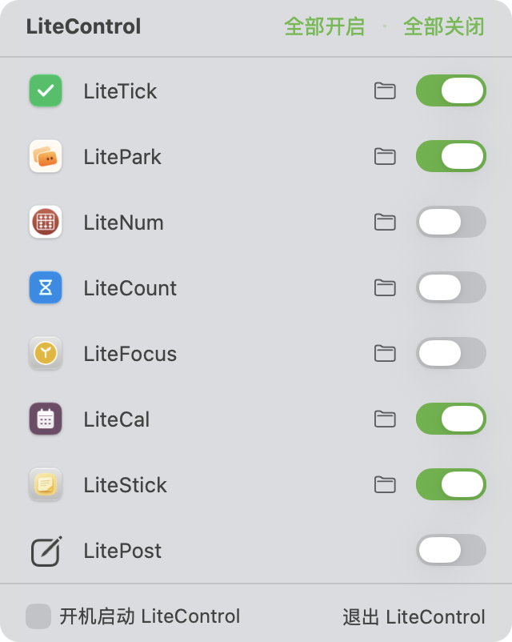
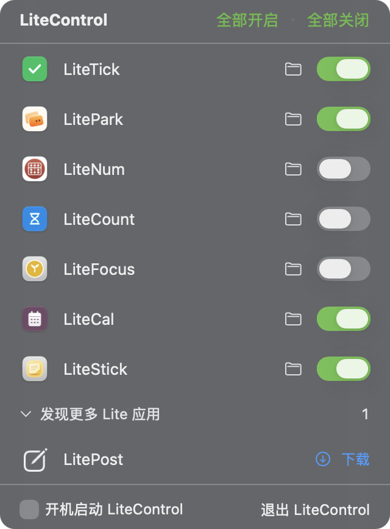

# LiteControl

[English](#english) · [简体中文](#简体中文)

## English

LiteControl puts your Lite apps in one macOS menu bar panel. Click the sliders icon to see which apps are installed and which are running.

[Download for Apple Silicon · macOS 14 or later](https://github.com/victor-zhang-2026/LiteControl/releases/latest)

| Installed apps | Discover more Lite apps |
| --- | --- |
|  |  |

**Install.** Download the app ZIP from Releases, unzip it, drag `LiteControl.app` into Applications, and open it. The checkbox at the bottom of the panel lets you start LiteControl at login. The panel labels in v2.0.1 are in Chinese.

- Use a switch to launch an app or request a normal quit. The switch follows the app when you open or quit it elsewhere. **全部开启** and **全部关闭** control all available installed apps.
- Click an app’s icon or name to open its GitHub repository. Expand **发现更多 Lite 应用** and click **下载** to visit a missing app’s Releases page. LiteControl detects the app after you install it.
- The catalog includes LiteTick, LitePark, LiteNum, LiteCount, LiteFocus, LiteCal, LiteStick, and LitePost. LitePost’s switch shows or closes its Hammerspoon note window. Its shortcuts and unsaved-note prompt still work.

**Local apps.** To add a Mac-specific native app, register it in `~/Library/Application Support/LiteControl/local-products.json`. Use a JSON array with `name`, `bundleID`, and an optional GitHub `repository` URL for each entry. LiteControl loads the file at launch and includes installed entries in individual and batch controls.

**Build.** Open `LiteControl.xcodeproj` in Xcode, or run `./scripts/build-app.sh` to create `build/LiteControl.app`. To select a local macOS SDK for the script, set `LITECONTROL_MACOS_SDK` to its path.

## 简体中文

LiteControl 把 Lite 系列应用集中到 macOS 菜单栏。点击滑杆图标，就能看到本机装了哪些应用、哪些正在运行。

[下载 Apple Silicon 版 · 适用于 macOS 14 及以上版本](https://github.com/victor-zhang-2026/LiteControl/releases/latest)

| 已安装应用 | 发现更多 Lite 应用 |
| --- | --- |
|  |  |

**安装**　从 Releases 下载应用 ZIP，解压后将 `LiteControl.app` 拖入「应用程序」并打开。勾选面板底部的「开机启动 LiteControl」，即可在登录后自动启动。

- 点击开关可启动或正常退出原生应用。在其他地方打开或退出应用，开关也会同步。「全部开启」「全部关闭」可批量控制已安装且可用的应用。
- 点击应用图标或名称可打开 GitHub 仓库。展开「发现更多 Lite 应用」，点击「下载」即可进入该产品的 Releases 页面。安装完成后，面板会自动识别。
- 公开目录包含 LiteTick、LitePark、LiteNum、LiteCount、LiteFocus、LiteCal、LiteStick 和 LitePost。LitePost 的开关控制 Hammerspoon 中的记录窗口，保留原有快捷键和未保存提醒。

**本机专用应用**　可在 `~/Library/Application Support/LiteControl/local-products.json` 中登记本机专用的原生应用。文件为 JSON 数组，每项含 `name`、`bundleID` 和可选的 GitHub 仓库地址 `repository`。LiteControl 启动时读取配置，已安装的条目可单独或批量控制。

**构建**　用 Xcode 打开 `LiteControl.xcodeproj`，或执行 `./scripts/build-app.sh` 生成 `build/LiteControl.app`。可通过 `LITECONTROL_MACOS_SDK` 指定本机 macOS SDK 的路径。
